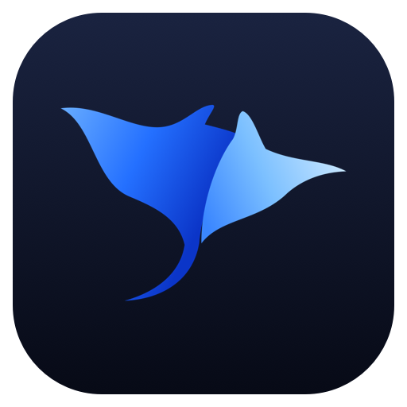

  
  <h1>OrynCore</h1>
  
<strong>基于 Rust 实现的跨平台代理核心</strong>

  

    
    
    
  

## 概述

OrynCore 是 Oryn 的高效代理客户端代理核心，OrynCore 的目标是兼容尽可能多的协议，并为客户端开发提供核心功能，OrynCore 目前不会开发服务端，OrynCore 目前已经基于 AI Agent 循环开发，旨在迅速改进和发现错误，任何第三方客户端均可使用 OrynCore 进行开发。

目前 Oryn 客户端仍在开发中，OrynCore 基础功能开发已经基本完成。

## 协议支持

- Shadowsocks(R)、Snell
- VMess、VLESS（含 Vision、REALITY）、AnyTLS
- Trojan、
- Hysteria 1/2、TUIC v5、WireGuard / AmneziaWG
- NaïveProxy、Mieru、Sudoku、ShadowQUIC、SSH、Tailscale、SOCKS5、HTTP

- **传输与安全**：WebSocket、gRPC、HTTPUpgrade、HTTP/2、XHTTP、mKCP、smux / yamux / h2mux；rustls、ECH、后量子密钥交换、浏览器 TLS 指纹、ShadowTLS
- 完全兼容的 mihomo （远程）规则与策略组（含 `smart`策略组）
- DNS 上已经支持 UDP / TCP / DoT / DoH / DoH3 / DoQ
- **重写**：HTTP/1.1 与 HTTP/2 MITM、重写、JQ 与 QuickJS 脚本，支持 Surge / Loon 模块（在部分平台客户端提供）

## 文档

- [docs/protocols/](docs/protocols/)：各协议实现说明

## 许可证

[GPL-3.0-or-later](LICENSE)
